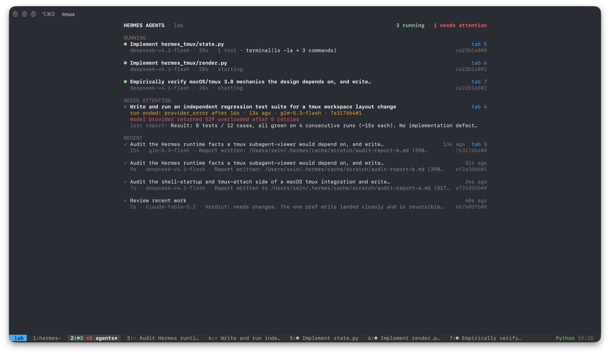
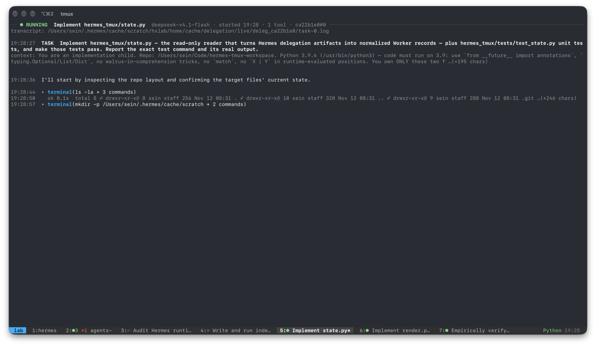
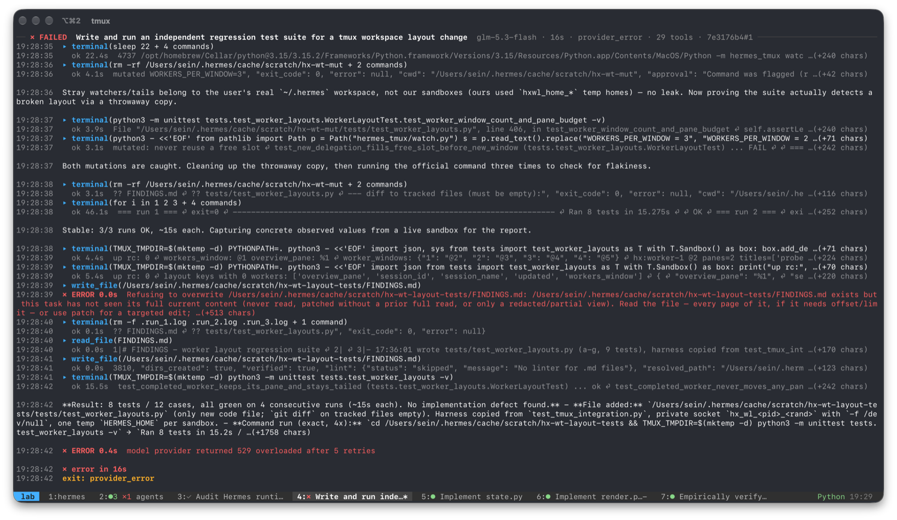
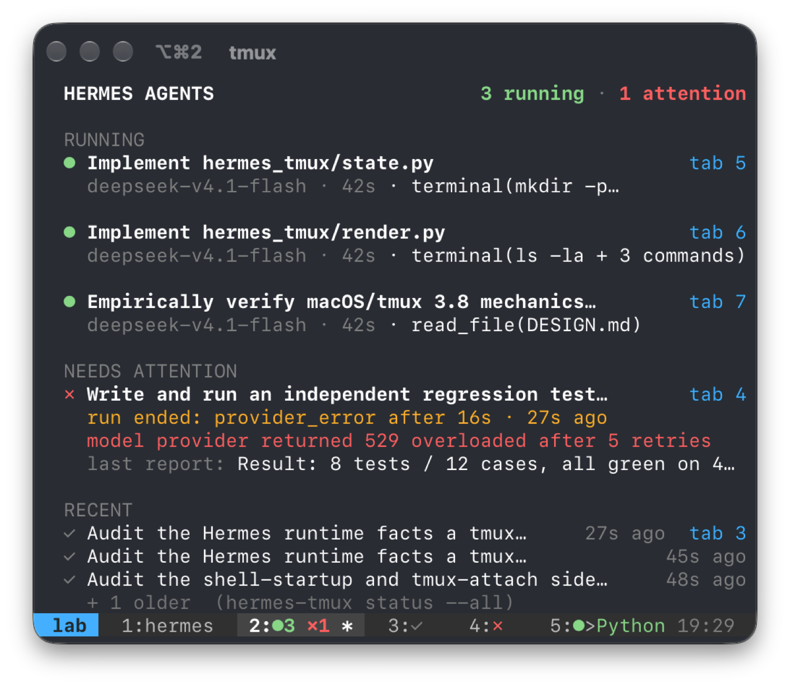

# hermes-tmux

Hermes subagents as live tmux tabs. Each worker Hermes delegates to gets a tab
of its own, named after its task, showing its transcript as it is written. An
`agents` tab says what is running, what needs a look, and what finished
recently, and `hx:mail` runs the local `hxmail` reader as a permanent tab beside
it. `logs` / `tests` / `debug` / `REA` panes open on demand.

It is a **read-only side-car**. Hermes core is not patched, configured, or
restarted. The workspace reads the delegation artifacts Hermes already writes
and renders them into tmux. Nothing is fabricated: if a fact is not in a Hermes
artifact or a review registry entry, the display says so.

It targets plain tmux, not a terminal emulator: Ghostty, iTerm2 and Terminal.app
are interchangeable clients, at any window size, several at once.



## Product shots

Every image here is a real capture of tmux while the tool was running; none is a
mockup. Provenance and what each one is meant to show is in
[docs/shots/README.md](docs/shots/README.md).

**The tab bar.** Worker tabs carry one stable name and a state glyph. The
`agents` badge counts running workers and unseen failures; when a worker tab is
in view, it shows a clickable `×` that closes the view, never the worker (in
`05-tab-bar.png` below, `agents` is the active window and the capture predates
the `×` mark; see [docs/shots/README.md](docs/shots/README.md)).


**A worker running.** One worker, one full-size pane: the border names the
state, task, model and run id; the pane follows the transcript Hermes is
writing, colouring tool calls and results one line each.



**A run that ended with an error.** `✕ FAILED … provider_error` is what Hermes
recorded about the agent run; the worker's own last report is quoted beside it,
and the tab stays until you look at it.



**A narrow client.** The same overview in a 996 px window: names are cut by tmux
from the client's own width, nothing is renamed, nothing overlaps.



## Install

Requirements: tmux (developed and tested on 3.8; the layout depends on 3.x id
and option formats), Python 3.9+, and a terminal that runs tmux. The package has
no third-party dependencies and no install step; Hermes core is not patched.

```sh
git clone https://github.com/archpc/hermes-tmux-workspace.git ~/Code/hermes-tmux-workspace
mkdir -p ~/.local/bin
ln -sf ~/Code/hermes-tmux-workspace/hermes-tmux ~/.local/bin/hermes-tmux
```

`hermes-tmux` is a launcher that adds its own repository to `sys.path`, so the
symlink is the whole installation. Optional: `scripts/tmux-attach` starts or
reattaches tmux when a terminal opens. It never calls `hermes-tmux up`; it is
independent of this tool and is here only because this tool is easier to reach
from a tmux session that always exists.

```sh
cp ~/Code/hermes-tmux-workspace/scripts/tmux-attach ~/.local/bin/
# in ~/.zshrc, interactive shells only:
#   [[ -o interactive ]] && ~/.local/bin/tmux-attach
```

Then, from the pane you run `hermes` in, inside tmux:

```sh
hermes-tmux up
```

Uninstall: `hermes-tmux down` closes only the panes it created; delete the
symlink afterwards.

## Quick start

```sh
# inside an existing tmux session, from the pane you run `hermes` in
hermes-tmux up            # build or repair the workspace: agents + hx:mail (idempotent)

hermes-tmux status        # the overview once; works outside tmux too
hermes-tmux status --all  # every recorded worker, not only the recent ones
hermes-tmux worker 2      # focus the 2nd worker tab
hermes-tmux open 427f4b2c#1   # open the transcript of any worker, old ones too
hermes-tmux close         # close the worker tab you are in (the view, never the worker)
hermes-tmux close-mark off    # remove the clickable × and restore the click binding (on | off | status)
hermes-tmux mail          # focus (or restore) the permanent hx:mail tab
hermes-tmux logs          # open/focus hx:logs   (also: tests debug rea)
hermes-tmux debug-report  # windows, panes, ownership flags, watcher pid
hermes-tmux down          # close only panes this tool created; a window that
                          # also holds one of your panes is left standing
```

`HERMES_TMUX=0` turns the tool off for one shell and always wins.

## What you see

The status line. Tabs are ordinary tmux windows, so they are clickable with
`mouse on` and reachable with the usual keys:

```
 main  1:hermes  2:●2 ✗1 agents  3:● Implement state.py  4:● Implement render.py  5:✗ Review layout change
```

`●` running, `◐` running but silent for ten minutes, `✓` done, `✗` the run ended
with an error. The `agents` badge counts running workers and unacknowledged
failures. A tab keeps one name for its whole life; how much of the name shows
is decided by tmux per client from that client's width, so a half-screen
terminal gets shorter names (down to number and glyph) and nothing is renamed.

The `agents` tab:

```
  HERMES AGENTS · main                                   2 running · 1 needs attention

  RUNNING
  ● Implement hermes_tmux/state.py                                              tab 3
    deepseek-v4.1-flash · 2m14s · 14 tools · terminal(python3 -m unittest …)  f0b03414#1

  NEEDS ATTENTION
  ✗ Review the layout change                                                    tab 5
    run ended: provider_error after 23s · 1m ago · glm-5.3-flash · 5e3e73aa#1
    model provider returned 529 overloaded after 5 retries
    last report: Result: 8 tests / 12 cases, all green on 4 consecutive runs…

  RECENT
  ✓ Audit the Hermes runtime facts a tmux subagent-viewer would depend on     12m ago
    4m16s · deepseek-v4.1-flash · Report written: audit-report-b.md (390 lines)…
```

A worker tab is one full-size pane. Its border names the state, the task and
the model; the pane follows the worker's real transcript, coloured by event,
with tool calls and results on one line each. Text is left to the terminal to
wrap, so resizing re-wraps it natively and never disturbs your scroll position.

Rules the display keeps:

- **One worker, one tab.** A tab is created once, appended at the end, and never
  renamed, moved, or repointed at another worker.
- **Tabs are for current work.** A worker gets a tab while it runs, including
  one that was already running when the workspace came up. Work that had
  finished before then is history: listed under RECENT, no tab.
- **Finished work leaves.** A finished worker keeps its tab for five minutes
  after it settled or was last looked at (`HERMES_TMUX_LINGER_S`), and never
  closes while it is the tab in view.
- **A failure waits for you.** A run that ended with an error keeps its tab and
  counts in the badge until you have looked at the tab; looking is the
  acknowledgement. Unseen for two hours, it becomes history.
- **Closing a tab is yours to decide.** A tab you close is not reopened. The
  worker stays listed in `agents`, and `hermes-tmux open <id>` brings its
  transcript back as a tab that stays until you close it.
- **The × on the tab in view closes the view, not the worker.** Click it, or run
  `hermes-tmux close`. The worker keeps running and the status line says so. It
  appears only on a worker tab, only while that tab is the one in view. There is
  no way to cancel a worker from here, and the × is not one.
- **At most eight worker tabs.** A new running worker takes the place of the
  oldest finished tab; a running tab is never closed to make room.
- **How a run ended is not a verdict on the work.** `run ended: provider_error`
  states what Hermes recorded about the agent run. The worker's own last report
  is quoted next to it; whether the work is good is yours to judge.
- **The transcript view is presentation only.** The file Hermes wrote is the
  only source; its path is the first line of the pane. Long entries are clipped
  with an explicit `(+N chars)`; lines that are not events are shown as
  written. `HERMES_TMUX_TRANSCRIPT=raw hermes-tmux up` uses plain `tail -F`.
- Workers with no transcript on disk get no tab rather than an empty one.

Environment:

| Variable | Effect |
|---|---|
| `HERMES_TMUX=0` | tool off for this shell |
| `HERMES_TMUX_TRANSCRIPT=raw` | worker panes run `tail -F` instead of the styled follower |
| `HERMES_TMUX_LINGER_S=<n>` | seconds a finished worker keeps its tab (default 300) |
| `HERMES_TMUX_CLOSE_MARK=0` | no × on worker tabs and the status-line click binding is left alone |
| `HERMES_TMUX_ASCII=1` | ASCII glyphs (`*` `~` `+` `x`, `...`); automatic when the locale is not UTF-8 |
| `NO_COLOR=1` | no colour in the overview and transcripts |

Colours are the terminal's own foreground plus 256-colour accents; truecolor is
not required. With several clients of different sizes attached, tmux sizes each
window for the client that used it last; the overview and tab bar follow.

## Auxiliary panes

| Pane | Shows | Never |
|---|---|---|
| `hx:logs` | `tail -n 200 -F` of the real `~/.hermes/logs/agent.log` | if the log is missing, one line naming the missing path, never invented log content |
| `hx:tests` | the last recorded run, or the opt-in command; `tests --run` records it | does not execute the suite by default (that would recurse into a running suite) |
| `hx:debug` | live env (`HERMES_HOME`, `HERMES_TMUX`, `TMUX_PANE`), session key, window/pane inventory with ownership flags | no invented health status |
| `hx:rea` | `rea --version` when the CLI exists, plus a note that REA MCP state is served by Hermes | no simulated REA output |

All four are created lazily on first use and reused afterwards.

## Where the data comes from

| Display | Source |
|---|---|
| worker id, task goal, model | `<HERMES_HOME>/cache/delegation/live/<deleg_id>/manifest.json` |
| tool activity, thinking, assistant text, final summary | `.../task-<n>.log` (append-only, written live by Hermes) |
| terminal state, exit reason, transcript path map | `state.db` table `async_delegations` (`state`, `result_json`, `task_json`) |
| review status | `cache/hermes-tmux/reviews.json` — written by `review run` or `review record` |

Review status is never inferred. A worker whose goal mentions "review" is still
an executor; only a registry entry makes a row a reviewer.

See `docs/DESIGN.md` for the architecture decision record and the evidence table,
and `docs/NOTES-tmux.md` for the tmux/macOS mechanics the layout depends on.

## Tests

```sh
TMUX_TMPDIR=$(mktemp -d) python3 -m unittest discover -s tests -t .
```

The suite needs no environment. It creates a **private tmux server** named
`hx_it_<pid>_<n>` per test and tears it down afterwards, so it never touches the
default socket or the user's sessions; the socket *file* it leaves behind is
removed by `tearDownModule` only when the server is gone, so a normal run leaves
no live process and `sessions/` empty.

Unit tests cover the gate, the state reader, the overview renderer, the labels
and the transcript formatter. The integration
suite drives **real, isolated tmux sessions** named `hx_it_<pid>_<n>`, each with
a private `HERMES_HOME`, and asserts against what tmux actually painted. It
never lists, renames, or kills any other session.

Quick subset, no tmux needed:

```sh
python3 -m unittest tests.test_render tests.test_labels tests.test_transcript tests.test_tab_merge
```

## Repository layout

| Path | Contents |
|---|---|
| `hermes-tmux` | launcher; a symlink to it on `PATH` is the whole install |
| `hermes_tmux/` | the package: `cli`, `gate`, `env`, `state`, `render`, `labels`, `transcript`, `watch`, `tmuxio`, `closemark` |
| `tests/` | 352 tests: pure unit tests plus an integration suite on private tmux servers |
| `docs/DESIGN.md` | architecture decision record, rejected alternatives, defect log |
| `docs/NOTES-tmux.md` | tmux and macOS mechanics the layout depends on |
| `docs/shots/` | the product shots used above, with provenance |
| `docs/case-study/` | the redesign from version 1 to version 3: PDF, report sources, evidence snapshot |
| `scripts/tmux-attach` | optional terminal-open hook that starts or reattaches tmux |

## License

MIT. See [LICENSE](LICENSE).
